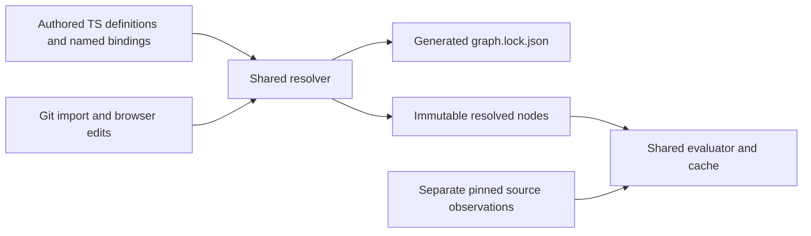
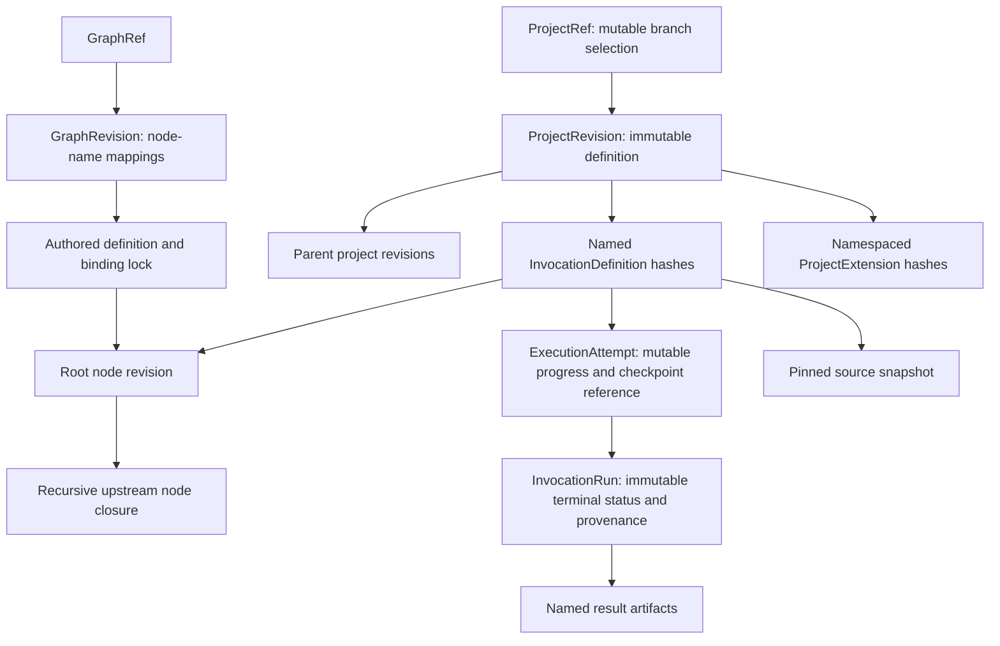

# Design Graphs And Workspaces

Taskyon's design-graph implementation is shared by browser and Node hosts. `@taskyon/comp-dag`
owns graph identity, traversal, stored-node compilation, invocations, runs, repository persistence,
and Git projections. `@taskyon/ui` owns reusable graph and workspace interactions. Host
applications provide composition, labels, commands, and storage capabilities.

## Node identity and origin

There are two supported definition origins:

- `hard-coded` nodes are supplied by a trusted runtime;
- `stored` nodes are loaded from TypeScript source in the writable design-graph repository.

Both compile to the same `DagNode` execution type. Stored nodes are content addressed and editable
through immutable replacement; imported bundles and Git repositories are import sources, not a
third read-only node category.

Stored source may use static imports when the node references an immutable module lock. The lock
maps every referrer/specifier pair to an exact content-addressed module object, so browser, CLI,
Git, and StorageClient execution use the same dependency closure without storing `node_modules`.
Import-free nodes do not carry an empty lock.

First-party module references are exact content hashes. Authored external package declarations use
compatibility ranges; committed locks pin exact versions and package integrity hashes. These pins
participate in importing node identities and propagate recursively downstream. Runtime compilation
checks the exact pins against approved package artifacts and rejects mismatches. Historical
runtime/package distribution remains future work; a lock alone does not transport package bytes.

`use.<alias>` is reserved for declared DAG dependencies. Network access is exposed as
`services.fetch`; the host mediates HTTPS requests and authorizes them by node hash, origin, and
read/write access. A compiled node reuses the authorization for repeated rows in that execution
context.

Definition origin is independent from execution effect. A `pure` node computes only from declared
inputs, while a `source` node observes an external environment. A stored node may be pure or a
source, and a hard-coded node may be pure or a source. Graph presentations therefore carry both
`definitionOrigin` and `isSource` rather than encoding either fact in one color or label.

`dagNodeRecordGraph.ts` owns stored-record indexing, closure and relation traversal, deletion
planning, immutable input rewrites, default merging, and graph compilation. `dagGraphView.ts`
projects runtime nodes into presentation data; it is not the compiler or repository.

## Reusable authored definitions

The current authoring format is `formatVersion: 3`. Put ordinary TypeScript declarations in
`nodes/`; each file owns one implementation, parameter/output contracts, and named connection sets:

```ts
export default {
  formatVersion: 3,
  localParamsSchema: {
    type: 'object',
    properties: { path: { type: 'string' } },
    required: ['path'],
  },
  inputsSchema: { data: { type: 'string' } },
  outputSchema: { type: 'number' },
  ids: {
    count: { inputs: { data: { source: 'projectInput' } } },
  },
  run: async ({ params, use }) => JSON.parse(await use.data({ path: params.path })).length,
}
```

`ids` supplies readable graph binding names. The resolver writes exact definition and recursive
application hashes into one generated `graph.lock.json`. Equivalent connections share one
application identity; different connections share their implementation without copying code.
Implementation edits affect every binding in that file. Labels and binding names remain in the
lock; changing a label does not invalidate a computation. Imports require exact module locks.

The initial strict input expressions are:

- `{ source: 'data' }`: one dependency; `role: 'exposed'` exposes its parameters.
- `{ source: 'data', path: 'records' }`: select a declared output path.
- `{ source: 'data', explode: 'records' }`: select one array element and expose `itemIndex`.
- `{ sources: { first: 'a', second: 'b' }, choose: { parameter: 'provider', default: 'first' } }`:
  select a compatible provider explicitly. Its parameters live under `providers.<name>`.

Connections use objects, not bare strings. `inputsSchema` describes upstream **outputs**, while
`ids.<name>.inputs` supplies connections. Parameters passed to a dependency belong in
`use.<alias>({ ... })`. The loader statically parses declarations without running their code and
rejects duplicates, missing sources, cycles, invalid paths, and incompatible contracts. Contract
compatibility is conservative equality apart from top-level titles/descriptions; it does not prove
arbitrary JSON Schema subtyping. Units and richer semantic compatibility remain future work.

When selecting an exploded candidate domain, select the provider in the call parameters or in
invocation variables. Invocation execution resolves each provider's domain separately. The direct
`node.call(...).study({ variables: ... })` helper rejects selector-changing variables for that
domain rather than reusing candidates from a different provider.

Inline expressions become resolved nodes in the immutable node pool. Their recursive hashes are
explicitly pinned in the lock's `unboundNodes` list, including expressions without an authored ID.
They do not generate authored placeholder files or a fake `run: () => null`. Named explode
declarations can use `definition: 'taskyon:explode'`, a source binding, and `settings.path`.
Built-in identities pin versioned library semantics and participate in downstream hashes. The
compiler rejects unavailable semantic identities; reproducing them requires the matching library
runtime. This is not yet a hash of the transitive compiler code or a standalone executable export.



Use parameters for compatible alternatives in one design space. Repeated bindings serve
simultaneous roles or different connections. Separate composition files, reusable subgraph
instances, filters, joins, reducers, fallback, ensembles, units, and adaptive search are later work.

## Source observations

Source nodes use immutable `SourceLockManifest` records to bind one observation to the exact node,
acquisition key, parameters, artifact, and timestamp. The source execution configuration selects a
refresh policy:

- `none` and `manual` reuse an existing manifest unless explicitly forced;
- `stale` refreshes after its configured duration;
- `always` refreshes once per execution run.

Projects may pin a source manifest without changing the immutable manifest itself. The environment
diagnostics classify definite source nodes and potential pure leaves so a host can explain which
values come from observations and which may still need user-supplied data.

## Repository object model

The StorageClient-backed design repository stores one shared immutable object pool:

```text
nodes/<content-hash>.ts
authoring/<source-hash>.ts
graph-locks/<content-hash>.json
modules/<content-hash>.json
module-locks/<content-hash>.json
graph-revisions/<content-hash>.json
project-revisions/<content-hash>.json
invocations/<content-hash>.json
extensions/<content-hash>.json
refs/<ref-name>.json
```

A graph revision maps names to immutable node hashes. A project ref points to a project revision;
the revision records parent hashes, a display name, friendly invocation names, and namespaced
extension hashes. Each invocation selects its computational root and input domains. Projects share
the global node pool and do not own copied node catalogs.

The paths above are the internal StorageClient layout. A source-only bundle instead contains:

```text
nodes/FeasibilitySummaryNode.ts
modules/reusableHelper.ts
imports/helperImports.json
projects/example.json
assets/report.md
graph.lock.json
```

`compileDesignGraphSources` resolves this bundle offline into canonical graph locks, resolved nodes,
module records, project revisions, invocations and extensions. It validates the committed source
lock before returning records. Only the lock is committed; the generated archives and path index
remain outside Git. `yarn graph:lock` explicitly updates the bundled example locks. Nodes reference an import declaration with
`moduleImports`; declarations map import specifiers to helper source paths or approved packages.
Project files name invocation roots by binding ID and contain the authored parameter/policy and
extension values. Extension values can use `node:binding`, `invocation:name` and `template:name`
references. Report template text lives in assets and is pinned during compilation.

Graph and source locks use schema version 3. A graph lock contains `bindings` mapping readable IDs
directly to recursive node hashes, sorted unique `unboundNodes` for resolved nodes without an
authored binding, and `nodeSources` pinning each compiled node declaration. Source locks add
`supportHashes` for raw helper modules and import declarations plus exact module/package
dependencies. Locks carry no copied schemas, wiring, structural settings, labels or parsed
definition hashes: full records live in the generated node pool, and presentation labels come from
the pinned authored bindings. The shared resolver returns these records as `resolvedNodes` and
labels as `bindingLabels`; `readAuthoredGraph` returns the validated resolution together with its
`files`. Changing lock serialization does not change node identity or builtin semantics. Old lock
formats are rejected and require an explicit `graph:lock` update from sources; saved data is not
migrated or deleted automatically.

A lock pins both sides of compilation: the exact inputs (`nodeSources`, `supportHashes`,
`moduleLocks`) and the resulting node identities (`bindings` values plus `unboundNodes`). Startup
recompiles the pinned sources and compares the result, so a compiler, helper-module or package
change that alters any node identity fails as an explicit stale lock instead of silently
orphaning revisions, runs and caches keyed by the old hashes. The resolver is treated as a black
box: behavior-preserving engine refactors leave the lock untouched. Hashing the transitive
compiler closure instead of the resolved identities remains planned work.

`exportDesignGraphSources` produces this source form from a current authoring snapshot. It rejects
historical roots and unsupported extension invocations instead of
silently discarding them. Use the self-contained portable snapshot export for exact historical
code and captured data; portable snapshots remain supported independently of source-only bundles.
Ordinary Git synchronization requests the source projection. Pinned studies retain only their
sourceSnapshotId references in Git; manifests and captured data stay in StorageClient. A Git-only
import reports missing pinned inputs at execution and never replaces them with live acquisitions.
All six Taskyon public examples also use flat source-only bundles. Their browser loader discovers
source files through Vite raw-module globs; Node diagnostics enumerate the same directories. No
generated repository index is checked in. This uses the same evaluator and stored-object schema.

Browser and Node hosts can use `compileDesignGraphSourcesWithCache` with injected cache reads and
writes. Node's `loadCachedDesignGraphSources` supplies an atomic filesystem adapter. The shared
cache validates the source fingerprint, entry shape and output checksum before reuse. Its identity
includes every source file, compiler semantic version and builtin semantic identities; file ordering
does not affect identity. Deletion or corruption rebuilds the bundle offline. Source edits still
require an updated graph lock. Bump the compiler cache version when source compilation semantics
change. Cache storage is trusted local acceleration, not an authentication boundary for imported
code. Storage read/write failure policy belongs to the adapter; optional browser caches should
report failures and continue from source rather than prevent startup.

Durable user graph/history and captured observations remain in StorageClient data storage. Runs,
results and compiled caches are disposable; retained exact inputs allow offline recomputation.
A content-hash filename alone does not imply disposability.

Readable references are authoring names; the generated lock records the resolved versions. Ordinary import
verifies the lock against declarations and rejects stale or tampered files. An intentional edit
uses the shared resolver to regenerate the lock, writes immutable objects first, and advances the
graph ref conditionally. Existing project invocations retain their pinned root hashes until
explicitly changed. Ref comparison uses the stored bytes and expected revision, independent of
JSON whitespace or key order.

Source-observation locks currently use the separate `SourceManifestRepository` over logical
StorageClient namespaces. A pinned invocation's portable archive includes its source snapshots,
manifests and artifact bytes; ordinary Git source exports exclude these records. Source observation identity stays separate from graph/code locks.

The pre-release authoring cutover uses `design-graph/authoring-v1`. Existing namespaces remain
available for deliberate export; they are not silently migrated or deleted. Explicit Node cutover
commands back up old bundles before replacing them. Canonical record parsing remains available
to the conversion machinery; graph-tool editing requires authored format 3.

### Generic acquisition

`httpSource.ts` supplies a reusable bounded GET source through mediated `services.fetch`; its
parameters are a URL and sorted string query parameters. It returns status, content type, URL,
and exact response bytes. A separate pure definition converts those bytes to a downstream
contract. Acquisition refresh and observation caching use the existing source machinery.
Only nodes declared with `effect: 'source'` receive host HTTP capabilities. Pure-node
`services.fetch` attempts fail before authorization or transport, and the normal DAG failure log
includes the node identity and instructions to move acquisition into a source input. This check
applies to both direct stored functions and sandbox protocol requests, including policy-aware fetch.
Raw host transports alone do not grant source HTTP access. The host must supply an authorization
handler with its transport, or explicitly inject an already-mediated capability through
`mediatedFetch`. Chat graph execution uses its existing authorized tool-context fetch capability;
it does not add a permissive authorization callback. Missing authorization fails at the first HTTP
attempt with a node-specific host-configuration error; denied authorization never reaches transport.
Non-network source capabilities and pinned offline replay do not require HTTP authorization.
Native fetch is removed in executable sandboxes; alternative network transports and worker creation
are removed and locked. Trusted custom-tool setup can install its authorized fetch wrapper. Browser execution additionally
uses an opaque sandboxed iframe with `connect-src 'none'` and a blob worker; source requests cross
only the authorized host protocol.

The sandbox response contract supports metadata and whole-body reads; it does not advertise
browser response streams or cloning APIs that the sandbox cannot supply.

`projectInputSource.ts` supplies UTF-8 file contents through a scoped host capability, restricted
to safe `inputs/` paths and 2 MiB. Project invocation hosts additionally bind the project folder. File
acquisition requires `effect: 'source'`; a pure node calling the shared project-input read capability
fails before host access, with instructions to connect a source reader instead. This restriction
does not ban other declared deterministic host capabilities.
For inspection before authoring a consumer, use `dagGraphProject` with `action: 'inspectProject'`
and `inputPath`. It returns existing UTF-8 text only within that project's input folder, capped at
64 KiB, without advancing the project ref. Larger files use the existing file-source execution
path. Inspecting an input does not record it as a saved calculation dependency; the calculation
must consume a captured source input.
`dagGraphProject` can inspect bindings, create/update an authored definition, import project input
files, and create or save named invocations. Use `saveInvocation` for an existing project. A run
returns `pinnedInvocationId`; save that invocation to retain its exact observations for replay.
Unpinned file-source runs refresh their observation; pinned runs retain the recorded bytes.
Mutable `inputs/` files bypass the immutable-object cache so separate clients observe edits.
Workflows can retain immutable input generations in content-addressed project subfolders while
source snapshots continue to pin the observed bytes independently of the graph lock.
The evaluator never needs AI to load or execute a saved graph.

Execution attempts contain mutable progress and checkpoints. A terminal `InvocationRun` contains
resolved execution identity, status, provenance, and named artifact hashes. Row artifacts and
their access index remain streamable so consumers do not need to materialize an entire study in
memory.

## Project And Invocation Vocabulary



Project extensions are typed, content-addressed definitions for deliberately saved dashboards,
workspaces, and other application-specific configuration. They are not copies of graph nodes or
result stores. Invocation roots select computational closures independently of graph catalog refs.
An invocation may be presented as a single design, study, or optimization based on its domains and
objectives; these are not separate invocation record types.

### Current Behavior And Target Gaps

The current `ExecutionAttempt` already has mutable progress, optional `totalRows`, and an optional
`checkpointArtifactId`. `InvocationRun` stores status, timings, resolved policy, provenance, and
named artifacts. The current writer stores NDJSON rows plus a row index; its summary contains row
count/status. It does not implement durable planner resumption simply because a checkpoint field
exists. The separate node cache already maps computation keys to node-output artifacts.

The execution policy requires source-aware deterministic row reuse. Current node/parameter cache
lookup still needs dependency traces and snapshot validation to meet that invariant. Source locks
are separate records, referenced by the current `InvocationDefinition.sourceSnapshotId` field.
The proposed name `InvocationAttempt` is not a current API type. Proposed final row-count and stopping-reason
fields would move small lifecycle facts onto the run itself. Dataset partitions, richer progress,
generic template ingestion, and invocation-backed document rendering remain future work.

The target excludes aliases, project IDs, run IDs, and worker completion order from computation
identity. Exact parameters, pinned root implementation, and consumed source observations determine
each result. A new source never consumed by prior rows may extend an invocation snapshot without
invalidating those rows. Counts before and after expansion must remain distinct; unavailable or
estimated totals must explain why. See the repository's design-graph execution policy for durable
invariants; this section does not imply those target capabilities have shipped.

## Git projections

Git is a synchronization projection above the authoritative StorageClient repository, not a
StorageClient backend. Ordinary Git synchronization selects `format: 'sources'` and exports readable
code, project settings and the committed graph lock. Captured inputs, manifests and application
history stay outside that projection. A source import creates a parented local application revision.
An existing portable-archive checkout must use a separate directory for ordinary Git sources.

`projectDesignGraphSnapshot` defaults to portable archive format and can project:

- the complete global repository;
- one project ref with its revision ancestry, invocations, extensions, and node closure;
- one graph revision with its ancestry and node closure;
- one node and its upstream closure.

Imports validate paths, schemas, content hashes, and closure references. Immutable objects are
written before refs, and refs use expected-current conditional writes. Synchronization only
fast-forwards: equal histories are unchanged, an ahead side is pushed or pulled, and divergent
histories return `conflict` without an automatic merge.

Static portable-archive hosts may include a generated `repository-index.json`. It is only a list of files so
the browser can enumerate a checkout over HTTP; it is not a hash-to-name manifest or part of graph
identity. Portable readers resolve readable archive paths and internal hash-addressed paths. Ordinary Git
adapters enumerate source directories and the root graph.lock.json without a generated index.

Node and graph snapshots include the transitive module-lock/module closure of every imported
stored node.

The browser adapter uses isomorphic-git with a private IndexedDB working tree. The Node adapter
uses a normal Git working directory. Both implement the same `DesignGraphGitSynchronizer` contract
and feed the same projection/import logic.

`DesignGraphGitSyncPane.vue` is the reusable UI boundary. The host owns its settings and injects a
`synchronize` function for the chosen snapshot selector. Authentication values stay transient;
the pane does not import a host store or persist credentials.

## Reusable graph views

`GraphCanvas.vue` renders generic `GraphData`. Its `GraphPresentationState` contains the stable
layout choice plus pan/zoom and node-drag preferences. Hosts may persist that small configuration
at their composition boundary while keeping selection, search, filters, camera position, and
temporary visibility local.

`GraphCanvasControls.vue` provides flow, vertical, and organic layouts, per-node visibility,
pan/zoom, node dragging, fit-visible, focus-selected, PNG copy, and SVG export.

`DagGraphExplorer.vue` composes the canvas with tree, graph, and list modes. It owns local search,
filtering, list selection, and context-menu positioning. Hosts opt into node creation and inject
toolbar, batch, node-action, and context-menu slots; the reusable component does not assume a
domain-specific create or delete policy.

## Workspace composition

`DockView.vue` supports leaf regions named `navigation`, `document`, and `tools`. A split inherits
the target region unless the host explicitly chooses another one, so opening a document does not
depend on whichever pane happened to be focused most recently. The add-pane menu searches the
host-provided view catalog.

`WorkspaceShell.vue` groups workspace entries by an optional `section` and supports an expanded or
compact navigation rail. Reusable panes do not import application-wide stores. The top-level page
or workspace host owns persisted widget configuration and passes each pane only its relevant
state and actions.

## Package boundaries

- `@taskyon/common/modules/graph` owns generic graph data, layout mapping, rendering, and
  presentation-state types.
- `@taskyon/comp-dag` owns computational DAG semantics and graph repository algorithms.
- `@taskyon/ui` owns reusable Vue graph, editor, Git-sync, and docking components.
- browser and Node packages own their storage, sandbox, and Git adapters.
- host applications own product navigation, project defaults, domain filters, commands, markers,
  and theme values.

Use package exports rather than relative imports across these boundaries. The packages remain
experimental, so their current source exports are not a stable third-party API.

## Git and application history

Git versions readable sources, project settings, report assets and the generated committed graph
lock. StorageClient owns saved application revisions, refs, captured inputs and source manifests.
Importing an edited Git source project preserves local application ancestry through a new parented
revision. Portable archives remain available for complete histories and captured inputs.

The committed source lock wraps the resolved graph lock and exact module locks, with hashes for raw
node/helper/import files. Internal graph locks continue to address resolved definitions and bindings.
Changing a local helper or exact approved package changes importing nodes and their downstream
computation identities. Code-lock updates are explicit; browser saves update runtime records and
Git export emits their matching source lock. Module-lock schema 3 rejects older unsupported records;
previous immutable data is retained and requires a compatible runtime for historical recovery.

Repeated acquisitions can have different observation timestamps but identical output content.
Pinned computation reuse compares consumed acquisition/content identities and reports the current
snapshot's observation IDs. Missing derived artifacts are recomputed; missing or corrupt pinned
inputs fail rather than silently fetching replacements. No new cleanup engine is provided. Cleanup
must protect reachable captured inputs even where inputs and derived artifacts share a namespace.

Source snapshots can contain many request hashes without enlarging Git. Compression and Merkle
indexing remain future scaling options. Cross-computer replication belongs entirely inside Taskyon's
StorageClient and is deferred; source/Git import is not proof of complete P2P transfer.
