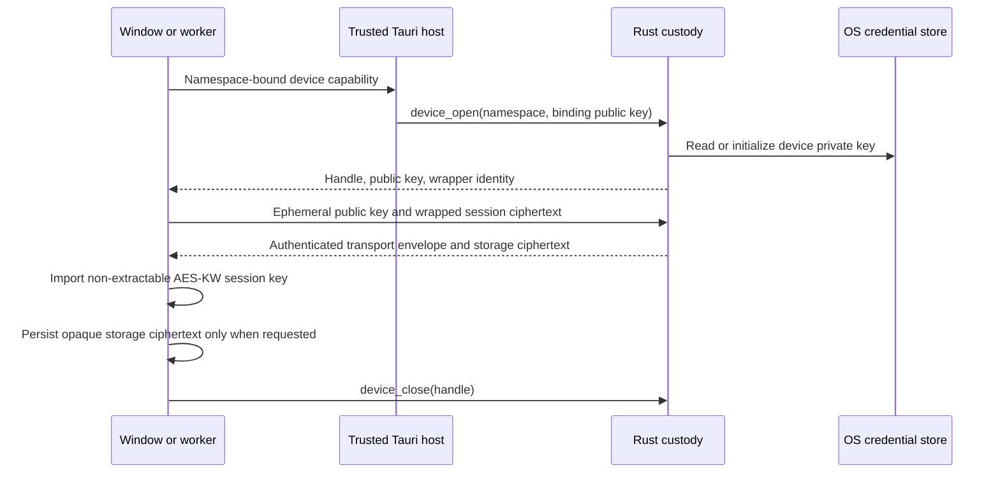

# Desktop device-key custody

Tauri desktop device private keys belong to Rust. Linux uses Secret Service, macOS uses Keychain,
and Windows uses Credential Manager through `keyring`. Unlock follows the OS login session; Taskyon
adds no application password. A locked or unavailable vault fails explicitly. There is no browser,
plaintext-file, AES-wrapper, or mock fallback in production. Unsupported platforms report unavailable.

## Ownership and security



The four native commands are `device_open`, `device_open_session`, `device_import_session`, and
`device_close`. Their app-manifest permissions allow only the main and headless app windows; remote
origins receive no grants. Rust additionally checks window labels and origins on every call and binds
handles to their caller. Development HTTP is allowed only at `http://localhost:9000` in debug builds.
Workers receive a private MessagePort capability selected by their host for one namespace. They cannot
select another namespace or use handles that were opened through another capability.

Native X25519 private keys never cross these commands. X25519 and HKDF-SHA256 derive separate
AES-GCM storage and transport keys. Authenticated metadata binds the format, wrapper, handle,
ephemeral public key and transport direction. The storage wrapper additionally binds the selected
binding public key and namespace. All-zero shared secrets, malformed lengths and tampered envelopes
are rejected. `native:v1:` envelopes contain a 12-byte nonce and 32-byte session key ciphertext with
a 16-byte authentication tag, encoded as unpadded base64url.

Rust keeps secrets in zeroizing values. Blocking credential operations run away from the WebView
thread. A cross-process file lock serializes initialization; an atomic public marker records the
initialized device public key. Missing or corrupt credentials after initialization fail rather than
silently creating another identity. Markers contain no private material. The OS vault and markers
must both survive a reinstall to preserve this bootstrap identity; removing both represents a fresh
installation. There is no device reset or rotation command in this version.

The runtime session key remains non-extractable WebCrypto state. Existing session sharing temporarily
unwraps **only the session key** as extractable, then wraps it to the sharing key. Mnemonic/user keys
retain their existing behavior. Unlocked session plaintext is not protected from compromised frontend
code. The four crypto commands do not export the device private key. This is not yet complete isolation
from compromised frontend code: the existing `tauri_run_bash_command` runs arbitrary host Bash and
its approval check is in JavaScript, which such code can bypass. Host commands may access the OS
credential store with the user's authority. A native approval or capability boundary is a separate
pending product decision. Native custody also does not protect against a privileged host or another
application authorized to read the OS credential store.

## Fresh desktop cutover

Desktop has not shipped. On selecting native custody, the persistence owner clears the desktop-owned legacy
`CryptoSession_*` bootstrap databases once, including retired agent namespaces, and uses
`CryptoSession_native-device-v1:<selected namespace>` for opaque session ciphertext. The device key
is stored under a versioned OS credential service and a hashed account name. Main, direct-agent and
ranking sessions select this owner at composition; worker runtimes accept the same scoped capability.
A public cutover marker records completion; native versioned crypto databases are retained.
There is no legacy reader or migration. Browser and CLI custody remain unchanged, and unrelated
settings, databases and files are retained. Browser bootstrap now fails on an unusable stored identity,
including WebKit's null key round-trip result, instead of replacing it silently.

Session creation/derivation does not persist ciphertext automatically. `persist=false` restores an
existing record without updating it; explicit persistence owns writes. Native handles close on session
replacement, runtime teardown and initialization failure; terminating a worker closes its host-owned
handles, including opens that finish after termination.

## Verification

From the frontend checkout in the project development shell:

```bash
cargo test --locked \
  --manifest-path src-tauri/Cargo.toml
node --import ./packages/tycli/src/register.ts \
  --experimental-strip-types --test \
  packages/runtime-browser/src/tests/\
nativeCryptoContract.test.ts
node --import ./packages/tycli/src/register.ts \
  --experimental-strip-types --test \
  packages/runtime-browser/src/tests/\
nativeCryptoBrowser.test.ts
```

The Rust suite injects a synthetic vault. The Node contract suite talks to an explicitly selected,
stdin-driven **test-only Rust subprocess**, never a production fallback. Browser tests close and
reopen isolated persistent Chromium and WebKit profiles, checking main and real-worker restoration,
non-extractability, legacy bootstrap deletion, retained unrelated storage, and decryption of previously
stored synthetic ciphertext. No personal profile or credential inventory is inspected. The existing
raw-browser IndexedDB key diagnostics remain valid compatibility checks; native custody does not make
WebKit's raw non-extractable X25519 persistence work.

Run host verification yourself; the sandbox does not inspect your login vault:

```bash
node scripts/diagnose-native-custody.mjs
node scripts/diagnose-native-custody.mjs \
  --synthetic-roundtrip
```

The default checks are read-only. The explicit round-trip mode writes, reads and deletes one randomly
named disposable synthetic OS credential and its temporary marker directory. It does not reset your
application state. Reports are timestamped, redacted JSON with restrictive permissions and are ignored
by Git. Return the report for review. A failed cleanup is a failure, even if key restoration worked.

Actual packaged Tauri command authorization, production WebKitGTK startup and a full app process
restart still require host smoke testing. Test Linux, macOS and Windows separately; synthetic vault
success does not establish OS integration or cross-platform build success. The added dependencies use
established RustCrypto primitives rather than bespoke cryptography. The lockfile pins compatible
`zeroize_derive`, `security-framework` and `dbus-secret-service` versions; do not update them past the
application's declared Rust minimum without reviewing the toolchain requirement.
